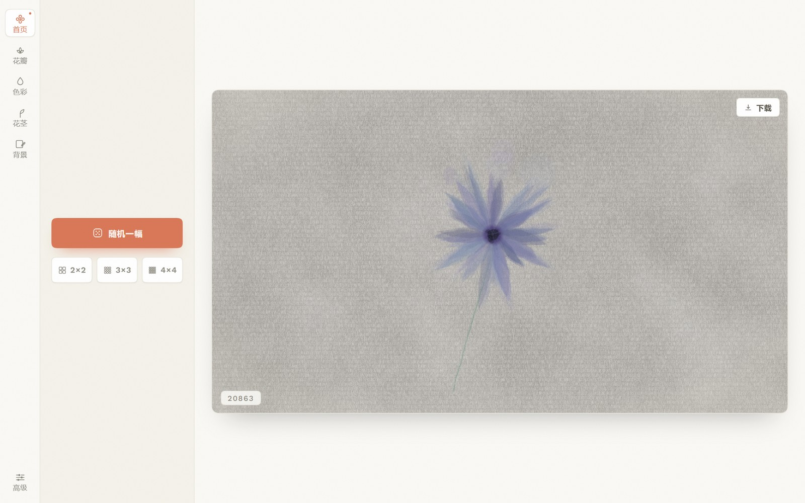
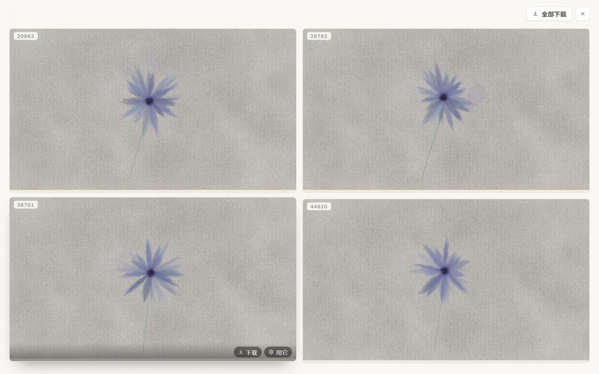

# 水色花笺 · Watercolor Studio

在浏览器里一键生成水彩花卉图像。同一随机种子永远渲染出同一幅画。

Generative watercolor flower studio in the browser — deterministic, seed-based botanical art rendered with React and SVG filters.



## 功能 / Features

- 一键随机生成，支持 2×2 / 3×3 / 4×4 批量生成变体并挑选
- 12 种配色方案（靛蓝幽兰、玫瑰灰粉、苍苔清影……）、6 种纸张预设
- 花瓣、花茎、背景与高级参数实时调节，拖动即见
- 确定性种子：记录种子编号即可复现任何一幅作品
- 导出 SVG 矢量图（1600×900）或 PNG 高清位图（3200×1800）
- 快捷键：空格随机生成，Ctrl+S 保存



## 运行 / Quick start

需要 Node.js 18+。

```bash
npm install
npm run dev      # http://localhost:5173
```

## 构建 / Build

```bash
npm run build    # 产物在 dist/，可部署到任意静态服务器
npm run preview  # 本地预览构建结果
```

纯前端项目，无后端、无环境变量；字体已本地化在 `src/fonts/`，断网也能正常渲染。

## 技术 / Tech

- React 18 + Vite 5
- 程序化 SVG：`feTurbulence` + `feDisplacementMap` 模拟水彩晕染与纸张纹理
- Park-Miller 伪随机数生成器，保证种子确定性
